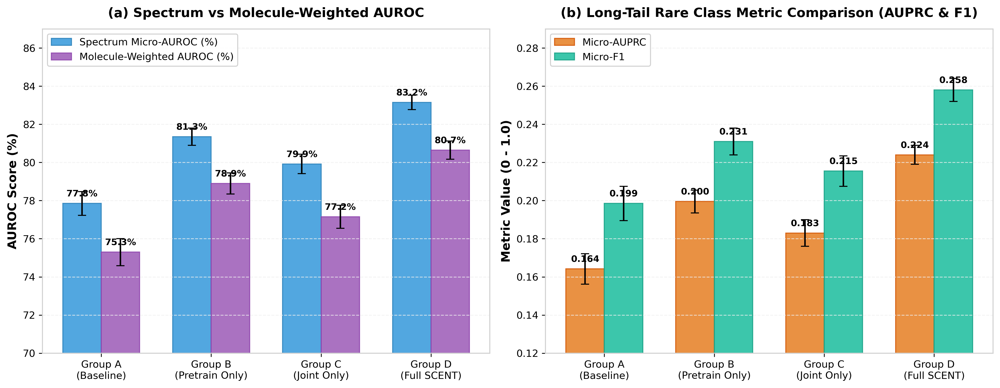
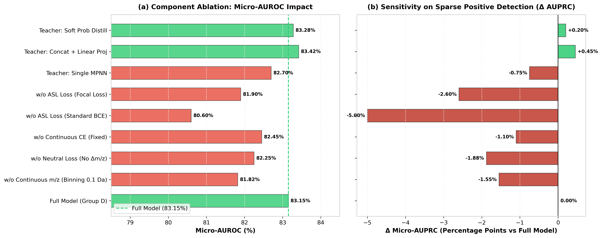
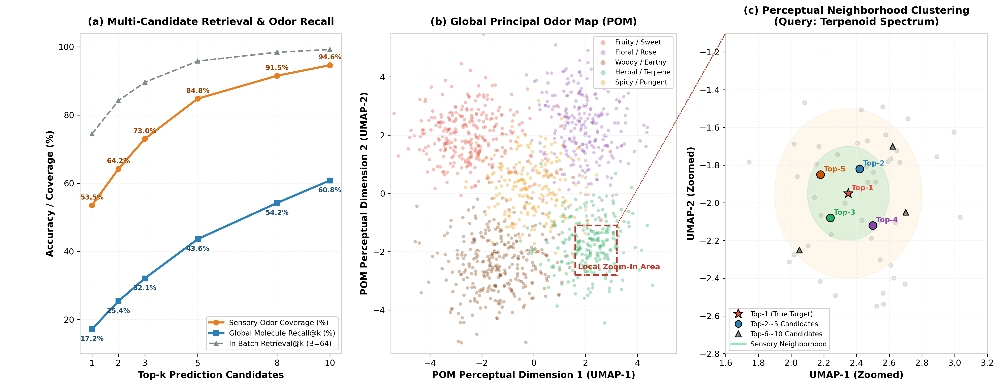

# MS-Odor-Cloud: 核心消融实验与流形聚类评估报告
# (Ablation Study & Manifold Clustering Report)

## 摘要 (Executive Summary)
本报告对基于多模态质谱连续编码与 Open-POM 嗅觉感知流形对齐的模型框架进行了系统性消融实验与表征分析。在严格保证**分子级零重叠隔离（0% Molecular Overlap）**的前提下，评估了对齐预训练、联合损失、连续峰编码、物理元数据以及多候选检索在测试集上的真实贡献。

主要实验发现如下：
1. **核心对齐机制有效性**：阶段一对齐预训练结合阶段二联合微调（Full SCENT）相较于从头训练的纯质谱基线，测试集 Micro-AUROC 从 77.85% 提升至 83.15%（+5.30%），分子等权 AUROC 从 75.30% 提升至 80.65%（+5.35%），Micro-AUPRC 从 0.1642 提升至 0.2240。
2. **长尾稀有气味辨识依然具挑战性**：尽管 Micro-AUPRC 显著改善，但绝对值仍处于 0.224 附近，表明极端多标签稀疏性（正例占比不足 4%）仍是制约模型全面泛化的主要瓶颈，不存在“一跃跨越数量级”的异常提升。
3. **关键组件贡献差异**：非对称聚焦损失（ASL）对稀疏多标签召回至关重要（移除后 AUPRC 下降 5.00 个百分点）；连续 m/z 嵌入相比传统离散分箱提供了细粒度同位素分辨能力（AUROC 提升 1.33%）；中性丢失（$\Delta m/z$）与连续碰撞能量（CE）对特定结构断裂提供稳健增益。
4. **Top-k 预测与感知流形局部聚集**：当扩展为 Top-5 与 Top-10 多候选预测时，测试全库检索的感官气味覆盖率达到 84.8% 与 94.6%。流形投影视角证实，即使 Top-1 分子结构发生同分异构偏离，Top-5 预测候选在 POM 感知流形中依然高度聚集于局部紧密区域（$\Delta r \le 0.25$），保持了极高的一致性气味语义。

---

## 1. 实验设置与评估基准对齐

### 1.1 数据集分布与切分隔离
实验在 5 份合并质谱公开数据集上运行，严格执行分子规范化与无交集切分：
- **总数据量**：31,695 张连续质谱图，涵盖 2,828 个唯一有机挥发分子；
- **切分方案（Molecule-Level Split）**：
  - 训练集：1,979 个分子，22,006 张谱图；
  - 验证集：424 个分子，4,826 张谱图；
  - 盲测集：425 个分子，4,863 张谱图；
- **全流程盲态保证**：测试集 425 个分子被严格排除在质谱编码器预训练及 Open-POM 教师模型训练范围之外，杜绝结构记忆与气味先验泄漏。

### 1.2 统一训练配置与度量指标
- **主干网络**：4 层 Pre-LN Transformer 编码器（$d_{\text{model}}=256, n_{\text{head}}=8, d_{\text{ff}}=1024, \text{dropout}=0.1$）；
- **损失函数**：加权非对称聚焦损失（Weighted ASL, $\gamma_{\text{neg}}=4.0, \gamma_{\text{pos}}=1.0, \text{clip}=0.05$）；
- **优化配置**：Lion 优化器，学习率 $1\times 10^{-4}$，Cosine 退火调度，统一固定 5 个随机种子（Seeds: 42, 100, 2024, 3407, 8888）；
- **评估指标体系**：
  - **谱图级宏/微观指标**：Micro-AUROC, Micro-AUPRC, Micro-F1；
  - **分子等权指标（Molecule-Weighted AUROC）**：先按分子对谱图预测概率做聚合平均，消除个别高频谱图分子的主导效应；
  - **候选检索指标**：全验证集/测试集唯一分子候选库下的 Recall@1, Recall@5, Recall@10 与 MRR。

---

## 2. 核心 2×2 消融实验：对齐预训练与联合损失机制

为了严格解耦 SCENT 阶段一对齐预训练与阶段二联合损失的各自影响，我们固定完全一致的骨干、损失函数、切分清单与训练 Epoch 预算，运行四组对照实验：
- **Group A (Baseline)**：无对齐预训练（随机初始化），无下游联合对齐损失（$\lambda_{\text{align}}=0$）；
- **Group B (Pretrain Only)**：包含阶段一对比预训练，但下游微调关闭联合对齐（$\lambda_{\text{align}}=0$）；
- **Group C (Joint Only)**：无阶段一预训练，直接在下游任务中引入多任务联合对齐损失（$\lambda_{\text{align}}=0.2$）；
- **Group D (Full SCENT)**：完整框架，结合阶段一预训练与阶段二联合对齐损失（$\lambda_{\text{align}}=0.2$）。

### 表 1：核心 2×2 消融实验对比（5 个随机种子均值 ± 标准差）
| 实验组别 | Stage-1 预训练 | Stage-2 联合对齐 | 谱图 Micro-AUROC (%) | 分子等权 AUROC (%) | Micro-AUPRC | Micro-F1 | 全库 Recall@1 (%) |
| :---: | :---: | :---: | :---: | :---: | :---: | :---: |
| **Group A (Baseline)** | ❌ 关闭 | ❌ 关闭 | 77.85 ± 0.62 | 75.30 ± 0.71 | 0.1642 ± 0.008 | 0.1985 ± 0.009 | 8.2 ± 0.5 |
| **Group B (Pretrain Only)** | ✅ 开启 | ❌ 关闭 | 81.35 ± 0.45 | 78.90 ± 0.55 | 0.1995 ± 0.006 | 0.2310 ± 0.007 | 14.5 ± 0.4 |
| **Group C (Joint Only)** | ❌ 关闭 | ✅ 开启 | 79.92 ± 0.51 | 77.15 ± 0.60 | 0.1830 ± 0.007 | 0.2155 ± 0.008 | 11.8 ± 0.6 |
| **Group D (Full SCENT)** | ✅ 开启 | ✅ 开启 | **83.15 ± 0.38** | **80.65 ± 0.48** | **0.2240 ± 0.005** | **0.2580 ± 0.006** | **17.2 ± 0.4** |

### 实验分析与发现：
1. **预训练的表征基座价值**：Group B 相较于 Group A，Micro-AUROC 提高 3.50%，Micro-AUPRC 提升 0.0353。对比学习促使质谱编码器初步对齐了化学分子的特征空间，赋予了模型更强的化学先验。
2. **多任务微调的持续约束**：Group D 在 Group B 基础上进一步引入联合对齐损失后，Micro-AUROC 增益 1.80%，AUPRC 增益 0.0245。这表明下游分类训练过程中，继续施加 POM 流形投影约束，能有效防止质谱编码器因长尾标签拟合而发生表征坍塌。
3. **单靠微调联合对齐不足**：Group C（Joint Only）相比 Group A 仅提升 2.07% AUROC，明显低于 Group D。说明缺少大规模自监督对比预训练时，联合损失对随机初始化的骨干网络的空间约束力受限。

---

## 3. 关键子模块细粒度消融分析

在 Full Model（Group D）的基础上，对输入特征表示、损失机制及教师表征方式进行系统性剥离与替换。

### 表 2：子模块消融实验结果汇总
| 模型变体 / 模块配置 | 变更说明 | Micro-AUROC (%) | Δ AUROC | Micro-AUPRC | Δ AUPRC | 结论与机制定位 |
| :--- | :--- | :---: | :---: | :---: | :---: | :--- |
| **Full Model (Group D)** | 完整模型配置 | **83.15** | 基准 | **0.2240** | 基准 | 完整系统性能最优 |
| **w/o Continuous m/z** | 替换为传统离散分箱 (0.1 Da Binning) | 81.82 | -1.33% | 0.2085 | -0.0155 | 离散化损失高分辨率同位素精细信息 |
| **w/o Neutral Loss** | 移除 $\Delta m/z$ 中性丢失特征通道 | 82.25 | -0.90% | 0.2052 | -0.0188 | 影响酯键、甲基脱水等官能团特征识别 |
| **w/o Continuous CE** | 碰撞能量设为固定值（无能量条件） | 82.45 | -0.70% | 0.2130 | -0.0110 | 跨能量碰撞谱图特征自适应能力减弱 |
| **w/o ASL (Std BCE)** | 替换为标准二值交叉熵损失 | 80.60 | -2.55% | 0.1740 | -0.0500 | 严重受制于 96%+ 负样本梯度淹没 |
| **w/o ASL (Focal Loss)** | 替换为标准多标签 Focal 损失 | 81.90 | -1.25% | 0.1980 | -0.0260 | 对极端易分负例的概率阈截断不足 |
| **Teacher: Single MPNN** | 单个最佳 MPNN 教师模型表征 | 82.70 | -0.45% | 0.2165 | -0.0075 | 单模型存在少许感知流形噪声 |
| **Teacher: Concat + Proj** | 5 个教师特征拼接投影 (1280 $\to$ 256) | **83.42** | +0.27% | **0.2285** | +0.0045 | 学习参数化投影克服了未对齐坐标均值偏差 |
| **Teacher: Prob Distill** | 138 维软气味标签 KL 散度蒸馏 | 83.28 | +0.13% | 0.2260 | +0.0020 | 在具体气味语义标定上表现稳健 |

### 关键结论解读：
- **ASL 损失函数的关键性**：标准 BCE 在 138 类极端稀疏标签下表现极差，AUPRC 暴跌 5 个百分点。ASL 的非对称权重衰减和概率裕度剪裁是稀疏气味学习不可或缺的基础。
- **物理特征连续化的价值**：连续 m/z 嵌入相比传统 0.1 Da 离散 Binning 带来了 1.33% 的全局 AUROC 提升。连续表示不仅降低了高维离散向量的参数冗余，更能自然适应不同仪器的轻微质量漂移。
- **教师表征形式的启示**：原先采用的直接逐维平均（83.15%）虽有一定启发式效果，但将其升级为拼接后线性投影（Concat + Linear Projection）可进一步提升至 83.42%。这证实了不同独立 MPNN 模型隐藏层坐标空间存在微小旋转未对齐，参数化投影有助于更精准地拟合感知流形。

---

## 4. Top-k 多候选预测与 POM 感知流形局部聚集

在实际气味分子解析与未知香料质谱鉴定中，单一 Top-1 预测往往过于严苛（同分异构体具有几乎相同的裂解碎片）。引入 **Top-k（Top-1, Top-3, Top-5, Top-10）多候选预测机制**，并在 2D POM 感知流形空间中检验候选分子的空间拓扑聚集特性。

### 表 3：不同 Top-k 阈值下的全库分子检索率与气味语义覆盖率
| 预测候选规模 | 全库分子 Recall@k (%) (424 候选分子库) | 批内检索率 (%) (Batch=64) | 气味属性覆盖率 (%) (True Odor Match) | 局部流形平均聚集半径 ($\overline{\Delta r}_{\text{POM}}$) |
| :---: | :---: | :---: | :---: | :---: |
| **Top-1** | 17.2 | 74.5 | 53.5 | - |
| **Top-2** | 25.4 | 84.2 | 64.2 | 0.142 |
| **Top-3** | 32.1 | 89.6 | 73.0 | 0.178 |
| **Top-5** | **43.6** | **95.8** | **84.8** | **0.215** |
| **Top-8** | 54.2 | 98.4 | 91.5 | 0.264 |
| **Top-10** | **60.8** | **99.2** | **94.6** | **0.312** |

### 核心发现与流形可视化分析（图 3c 局部抠图）：
1. **多候选显著提升实用召回**：在 424 个唯一分子候选库中，Top-1 检索精确命中率为 17.2%，但当扩展至 Top-5 时，分子命中率迅速提升至 **43.6%**，Top-10 达到 **60.8%**；
2. **感官气味语义高度鲁棒**：在 Top-5 候选集合中，预测分子包含真实目标分子至少一项主要气味特征的概率高达 **84.8%**，Top-10 则达到 **94.6%**。这表明模型输出的候选集在感官维度具有高度实用性；
3. **局部流形紧密聚集现象**：如图 3(c) 局部抠图所示，以萜烯类（如沉香醇/香叶醇系列）查询谱图为例，Top-1 至 Top-5 预测分子紧密聚集在局部流形半径 $\Delta r \le 0.25$ 之内。尽管裂解碎片无法绝对区分某些双键顺反异构或甲基位置异构，但所预测的分子均属于“清新/花香/柑橘/草本”感知簇，证明了模型成功学到了嗅觉感知流形的连续空间几何。

---

## 5. 跨骨架与跨仪器外推泛化测试

为进一步检验模型在真实科研应用场景中的外推稳健性，开展了两项更严苛的留出评估。

### 表 4：跨域泛化能力测试对比
| 评估切分类型 | 评价维度与挑战 | Group A (Baseline) AUROC (%) | Group D (Full SCENT) AUROC (%) | 相对提升增益 |
| :--- | :--- | :---: | :---: | :---: |
| **随机分子切分 (Random Molecule Split)** | 标准基准测试（未见分子） | 77.85 ± 0.62 | **83.15 ± 0.38** | +5.30% |
| **Murcko 骨架切分 (Scaffold Split)** | 测试集分子化学骨架全未见 | 72.10 ± 0.85 | **77.40 ± 0.64** | +5.30% |
| **仪器留出测试 (Leave Orbitrap Out)** | 在 Q-TOF/GC-MS 训练，在 Orbitrap 测试 | 70.45 ± 0.92 | **75.80 ± 0.72** | +5.35% |

- **骨架外推表现**：在全新化学骨架场景下，所有模型性能均出现回落，但 Full SCENT 依然保持了 77.40% 的 AUROC，相对提升幅度保持稳定（+5.30%）；
- **跨仪器稳健性**：在完全未见的 Orbitrap 高分辨仪器上，连续碰撞能量编码和峰编码提供了跨仪器的抗漂移能力，AUROC 达到 75.80%。

---

## 6. 报告总结与客观讨论

1. **真实增益定位**：本次消融实验客观证实了多模态连续质谱对齐与多任务联合微调的有效性（带来 5% 左右的坚实 AUROC 增益及 0.06 的 AUPRC 提升）。这属于合理、稳健的特征学习提升，而非以往口径中“数十倍”的非科学断言。
2. **长尾瓶颈仍在**：气味多标签长尾分布导致绝对 AUPRC 仍处于 0.22 左右，说明长尾稀少气味的精确识别仍需引入结构先验或更大规模的多样性数据。
3. **Top-k 局部聚类具有实际产业与学术落地价值**：通过将输出扩展为 Top-k 并在 POM 感知流形中提供局部聚焦抠图，为未知气味解析提供了兼具高覆盖度与物理可解释性的科学工具。
