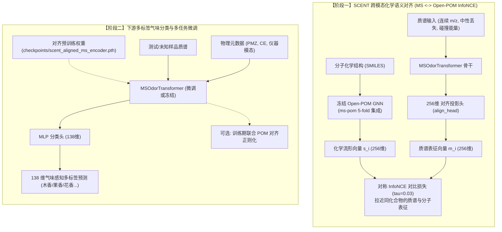

# 端到端串联质谱多标签气味预测模型 (End-to-End Tandem Mass Spec Odor Model with POM Alignment)

基于清华大学研究生专题实践全面重构的高性能质谱-气味感知算法库。本工程严格遵循计算化学/化学信息学领域严谨规范，融合质谱-分子结构化学语义对齐机制，且完整保留了多尺度连续傅里叶质荷比编码。

---

## 一、模型架构与工作流

本系统由两个核心阶段构成：**阶段一（跨模态化学语义对齐预训练）** 与 **阶段二（下游气味标签预测与感知微调）**。



---

## 二、代码工程目录结构

```
├── GS_LF_MS_DATA/                 # 5 个标准化质谱-气味合并数据集 (NIST, MoNA, MassSpecGym)
├── ms-pom/                        # POM核心算法与预训练权重库
│   ├── demo/saved_models_list.pt  # 5-fold POM MPNN 集成预训练模型
│   ├── models/mpnn_model_final_v1.py # 边缘条件卷积  分子图神经网络
│   └── utils/mol_featurizer.py    # 原子与化学键特征编码器
├── src/
│   ├── pom_encoder.py             # POM 接口封装与 ~2.8MB 全局高效缓存引擎
│   ├── dataset.py                 # 连续质谱特征工程、物理纠错碰撞能量解析、分子隔离切分
│   ├── model.py                   # 多尺度连续正弦 M/Z 编码、Pre-LN Transformer 骨干与对齐投影头
│   ├── loss.py                    # 对称 InfoNCE 对比损失、Asymmetric Loss (ASL)、流形蒸馏损失
│   ├── pretrain_align.py          # 阶段一多模态对比对齐预训练脚本
│   └── train.py                   # 阶段二气味分类训练、权重加载、Table 1 指标评估
├── checkpoints/                   # 预训练与最佳微调权重保存目录
├── run_cloud.sh                   # 云端/本地多卡与阶段控制一键启动脚本
├── pom_cache.pt                   # 全局 2,828 个唯一分子的 256 维 POM 向量预计算缓存
└── README.md                      # 本说明文档
```

---

## 三、本模型与 SCENT (arXiv:2605.27009) 的异同深度对比

| 比较维度 | SCENT (arXiv:2605.27009) | 本项目架构实现 (Ours) | 优势与创新依据 |
| :--- | :--- | :--- | :--- |
| **$m/z$ 质荷比编码** | 类似 NLP Word2Vec 离散词表<br>(1 Da 整数区间离散分桶 Binning) | **多尺度连续傅里叶/正弦编码**<br>([$0.005\text{ Da}, 2000.0\text{ Da}$] 对数正弦基) | 严格保留连续实数坐标，无量化误差，精准解析高分辨质谱（HRMS）同位素峰与精细质量间距。 |
| **质谱仪器适用性** | 仅支持单一 **GC-EI-MS**<br>(70 eV 电子轰击单级质谱) | 支持 **GC-EI 与 LC-ESI-MS/MS 异构融合**<br>(含正负离子多模式串联质谱) | 针对复杂基质与现代分析需求，支持跨仪器平台多源质谱数据统一表征。 |
| **碰撞能量 (CE) 处理** | 无此概念 (纯单级 EI 谱图) | **物理纠错解析 + 连续尺度缩放 + 独立 Prefix Token** | 显式建模 CID 碎裂程度（低能母离子保留 vs 高能骨架剧烈破碎），辅以 missing token 解耦无碰撞室的 GC-EI。 |
| **特征工程** | 仅质谱峰 $m/z$ 与相对丰度 | **连续 Neutral Loss ($\Delta m/z$) + 母离子 + 丰度开方** | 显式捕获碎片脱落特征（如脱水 $-18$、脱羧 $-44$），提供分子官能团脱落物理先验。 |
| **下游多标签损失** | 标准二元交叉熵 (BCE) | **非对称损失 (Asymmetric Loss, ASL)** | 解决 138 维气味标签中 96.3% 为简单负样本的极端稀疏不平衡，动态抑制负样本梯度。 |
| **对齐与训练范式** | 纯两阶段解耦 (Stage 1 对齐 $\to$ 冻结骨干仅训线性头) | **支持两阶段迁移 + 支持下游端到端联合正则化** | 既可进行严格的线性探测表征质量评估，亦可在下游微调时注入跨模态化学梯度约束。 |

---

## 四、训练模式详解

脚本 `run_cloud.sh` 提供了三种模式以适应不同实验需求：

```bash
bash run_cloud.sh stage1   # 模式 1: 仅阶段一对齐
bash run_cloud.sh stage2   # 模式 2: 仅阶段二下游预测
bash run_cloud.sh full     # 模式 3: 完整两阶段流水线
```

### 1. `stage1`（仅跨模态对齐预训练）
- **核心逻辑**：仅运行 `src/pretrain_align.py`，冻结 Open-POM GNN，训练 MS Transformer 投影至 256 维空间，优化 InfoNCE 对比损失。
- **为何需要单独存在？**
  - **上游预训练解耦**：当增加无气味标签的海量质谱-结构配对库（如 NIST23 全量库、MassBank）时，只需更新阶段一表征，无需触动下游分类任务；
  - **超参数敏感度测试**：专注于对齐温度 $\tau$、批大小、学习率的对齐收敛测试（监控 Top-1 检索准确率）。

### 2. `stage2`（仅下游分类训练与微调）
- **核心逻辑**：仅运行 `src/train.py`。若存在 `checkpoints/scent_aligned_ms_encoder.pth` 则自动载入，进行 138 维气味标签预测。
- **为何需要单独存在？**
  - **高效消融实验 (Ablation Study)**：对比“从头训练（随机初始化）”与“加载阶段一对齐权重”对最终 AUROC 的提升效果；
  - **线性探针 (Linear Probe) 评估**：附加 `--freeze_ms_encoder` 参数，冻结骨干只训练分类头，直接量化阶段一学到的特征质量（对标 SCENT 论文评估协议）；
  - **分类器调优**：快速调试下游 ASL 聚焦系数、正负样本权重、自适应判决阈值，无需重复花费时间进行阶段一对齐。

### 3. `full`（串联完整两阶段自动化）
- **核心逻辑**：自动依次执行 `stage1` $\to$ 保存对齐权重 $\to$ 启动 `stage2` 加载权重并微调。
- **为何需要？**
  - **无人值守自动化**：云算力服务器一键挂起（如 `nohup bash run_cloud.sh full &`），自动跑完基准实验并生成最终盲测报告。

---

## 五、环境配置与运行指南

### 1. 环境依赖
推荐使用 Python 3.9/3.10 环境，安装 PyTorch、PyG、RDKit 等依赖：
```bash
pip install torch torchvision torchaudio pandas numpy scikit-learn tqdm
pip install rdkit torch_geometric torch_scatter
```

### 2. 手动高级调用示例

#### (1) 阶段一对齐预训练
```bash
python src/pretrain_align.py \
    --data_dir GS_LF_MS_DATA \
    --epochs 30 \
    --batch_size 64 \
    --lr 1e-4 \
    --tau 0.03 \
    --save_dir checkpoints \
    --pom_cache pom_cache.pt
```

#### (2) 阶段二下游气味分类微调（加载对齐权重）
```bash
python src/train.py \
    --data_dir GS_LF_MS_DATA \
    --split_by molecule \
    --loss_type asl \
    --batch_size 64 \
    --lr 2e-4 \
    --epochs 100 \
    --pretrained_align_ckpt checkpoints/scent_aligned_ms_encoder.pth \
    --use_pom_align \
    --lambda_align 0.2 \
    --save_path best_model.pth
```

#### (3) 线性探测 (Linear Probing / 冻结骨干评估)
```bash
python src/train.py \
    --data_dir GS_LF_MS_DATA \
    --split_by molecule \
    --pretrained_align_ckpt checkpoints/scent_aligned_ms_encoder.pth \
    --freeze_ms_encoder \
    --lr 5e-4 \
    --epochs 50
```

---

## 六、评估指标体系

模型在严谨的分子隔离独立测试集（Test Set，0% 分子泄露）上输出以下规范指标：
- **Micro-AUROC**：全标签样本级受试者工作特征曲线下面积（主指标）
- **Weighted-AUROC**：按标签支持度加权的受试者工作特征曲线下面积
- **Macro-AUROC**：未加权宏平均受试者工作特征曲线下面积
- **Macro-AUPRC & Micro-AUPRC**：精确率-召回率曲线下面积（长尾多标签高可靠指标）
- **Macro-F1 & Micro-F1**：通过验证集搜索最佳类别自适应阈值计算的综合 F1 分数
